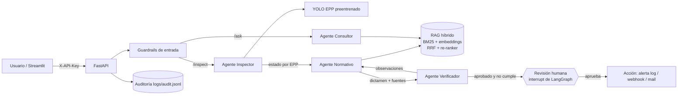

# Asistente de cumplimiento de EPP – TP final PLN III

POC multiagente con RAG que verifica, a partir de una imagen y de la zona de trabajo, si una
persona usa los elementos de protección personal (EPP) exigidos, y responde consultas sobre la
normativa aplicable (Ley 19587, Decreto 351/79, Resolución SRT 299/2011, Ley 25326) y la política
interna de la planta.

## Cómo correrlo en GitHub Codespaces

1. Subí este repositorio a GitHub (por ejemplo, `tp-pln3-epp`).
2. **Opcional – claves del LLM.** En GitHub: *Settings → Codespaces → Secrets → New secret*.
   Lo más simple es `GROQ_API_KEY`, que es gratuita (https://console.groq.com) y es el proveedor
   que usa la cátedra en la Teoría 3. También sirven `ANTHROPIC_API_KEY` u `OPENAI_API_KEY`.
   Sumá `APP_API_KEY` (cualquier texto, es la clave para llamar a la API) y dales acceso a este
   repositorio. Sin claves, el sistema corre en **modo mock**: funciona de punta a punta con
   respuestas simuladas.
3. En el repositorio: *Code → Codespaces → Create codespace on main*. El contenedor instala las
   dependencias y construye el índice del RAG solo (tarda unos minutos la primera vez).
4. En la terminal del Codespace:

```bash
uvicorn eppagent.api.main:app --reload --port 8000
```

5. Se abre el puerto 8000. Entrá a `/docs` para probar la API desde el navegador
   (botón *Authorize* → `X-API-Key` = tu `APP_API_KEY`, o `demo-key` si no la configuraste).

Demo visual opcional, en otra terminal:

```bash
streamlit run app_streamlit.py --server.port 8501
```

### Comandos útiles

```bash
make test        # tests en modo mock (no gastan tokens)
make eval        # métricas -> reports/metrics.json y reports/metrics.md
make index       # reconstruye el índice después de cambiar data/corpus
make images      # baja 100 imágenes reales de prueba (dataset público de EPP)
make eval-vision # evalúa el detector y el sistema completo con esas imágenes
make mock        # levanta la API en modo mock aunque haya claves
```

## Ejemplos de uso

```bash
# Consulta normativa
curl -X POST localhost:8000/ask -H "X-API-Key: demo-key" -H "Content-Type: application/json" \
  -d '{"pregunta": "¿Qué EPP es obligatorio en el depósito?"}'

# Inspección con imagen de ejemplo
curl -X POST localhost:8000/inspect -H "X-API-Key: demo-key" \
  -F zona=deposito -F imagen=@data/samples/operario_deposito_sin_chaleco.jpg

# Inspección enviando las detecciones (sin imagen)
curl -X POST localhost:8000/inspect/json -H "X-API-Key: demo-key" -H "Content-Type: application/json" \
  -d '{"zona": "laboratorio", "detecciones": [{"label": "goggles"}, {"label": "no_glove"}, {"label": "mask"}]}'

# Si no cumple, la respuesta trae "estado_alerta": "pendiente_aprobacion" y un run_id.
# Revisión humana: aprobar (envía la alerta) o rechazar
curl -X POST localhost:8000/inspect/<run_id>/decision -H "X-API-Key: demo-key" \
  -H "Content-Type: application/json" -d '{"aprobar": true}'

# Diagrama del grafo de LangGraph (Mermaid)
curl localhost:8000/grafo -H "X-API-Key: demo-key"
```

## Arquitectura



| Requisito del TP | Dónde está |
|---|---|
| API FastAPI | `src/eppagent/api/main.py` |
| Al menos dos agentes con comunicación | Inspector, Normativo, Verificador y Consultor (`src/eppagent/agents/`), orquestados con un `StateGraph` de **LangGraph** (`orchestrator.py`): mensajes estructurados entre nodos, arista condicional para el bucle de reflexión y *checkpointer* para guardar el estado |
| RAG con *retriever* y *ranker*, trazabilidad | `src/eppagent/rag/index.py`: BM25 + embeddings, fusión RRF, *cross-encoder*; cada fragmento citado como `[F:doc#n]` |
| Seguridad | `src/eppagent/security/guardrails.py`: API key, detección de inyección de prompts por reglas y con **Prompt Guard 2** de Meta (opcional, como en la Teoría 2), enmascarado de datos personales, validación de imágenes, validación de salidas con Pydantic, control de citas, **revisión humana** antes de la acción (`interrupt` de LangGraph) y auditoría |
| Modelo CNN/ViT preentrenado (opcional) | `src/eppagent/vision/detector.py`: YOLOv8 de EPP desde Hugging Face |
| Flujo modular y monitoreable | `orchestrator.py`, traza completa entre agentes en cada respuesta, *logging* y `/metrics` |
| Optimización de costos y latencia | Selección dinámica de modelo (chico para verificar y responder, grande para dictaminar), caché de respuestas, reducción del contexto (top-k = 4), límite de tokens y parada temprana del bucle de reflexión |
| Acción automática (opcional) | `src/eppagent/actions/notifier.py`: alerta por log, webhook (Slack, Teams, n8n) o SMTP, después de la aprobación humana |
| Proveedores de LLM | Groq (`openai/gpt-oss-20b` y `gpt-oss-120b`, como en la Teoría 3), Anthropic, OpenAI o mock |
| Métricas | `scripts/evaluate.py`: P@k, R@k, MRR y nDCG del RAG; ROUGE-L, F1 y similitud semántica de las respuestas; exactitud de los agentes, rondas de reflexión, latencia y tokens |

## Estructura

```
configs/            config.yaml (modelos, RAG, seguridad) y zonas.yaml (EPP por zona)
data/corpus/        documentos del RAG (normas oficiales por artículo + documentos internos)
data/eval/          30 preguntas con respuesta de referencia y 15 inspecciones etiquetadas
data/samples/       imágenes sintéticas de ejemplo con sus detecciones (modo mock)
src/eppagent/       código del sistema
scripts/            construcción del índice y evaluación
tests/              tests de componentes críticos (pytest)
docs/informe.md     esqueleto del informe técnico
reports/            métricas generadas
```

## Evaluación con imágenes reales

`scripts/fetch_eval_images.py` baja la partición de prueba del dataset público
[keremberke/protective-equipment-detection](https://huggingface.co/datasets/keremberke/protective-equipment-detection)
(CC BY 4.0, origen Roboflow Universe), elige 100 imágenes balanceadas entre casos que cumplen y que
no cumplen, les asigna una zona (laboratorio o mantenimiento) y calcula el valor esperado a partir
de las etiquetas reales. El detector YOLO se entrenó con la partición de entrenamiento de ese
dataset, así que estas imágenes no las vio.

`scripts/evaluate_vision.py` mide:

- **Detector:** exactitud del estado por elemento y precisión y recall de «no usa».
- **Sistema completo:** exactitud de la decisión de cumplimiento y de los faltantes, latencia y tokens.

Con `--solo-detector` no usa el LLM. Con `--max 30` limita la cantidad de imágenes si la API
gratuita de Groq corta por límite de pedidos.

## Prompt Guard 2 (opcional)

El modelo `meta-llama/Llama-Prompt-Guard-2-86M` tiene acceso restringido: hay que aceptar la
licencia en Hugging Face, crear el secret `HF_TOKEN` y poner `prompt_guard.enabled: true` en
`configs/config.yaml` (o la variable `PROMPT_GUARD=true`). Si no está disponible, quedan activas
las reglas por expresiones regulares.

## Notas

- El corpus usa los textos oficiales de InfoLEG, salvo el capítulo 19 del Anexo I del Decreto 351/79 y la
  Disposición 10/2015, que siguen como resúmenes (ver `data/corpus/README.md`).
- El detector YOLO por defecto no detecta protectores auditivos ni chalecos: esos elementos quedan
  como "no visible" salvo que se use otro modelo. Se puede cambiar en `configs/config.yaml`.
- Las imágenes recibidas no se guardan: se procesan en un directorio temporal.
